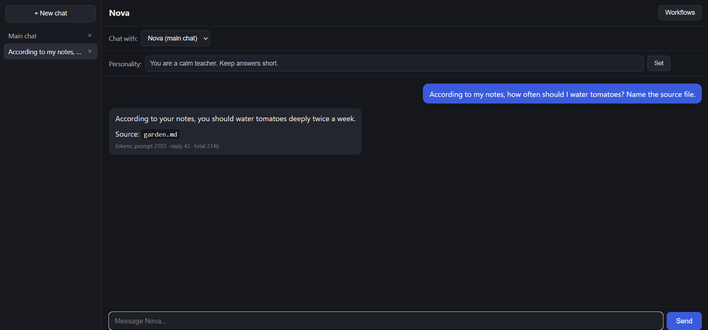
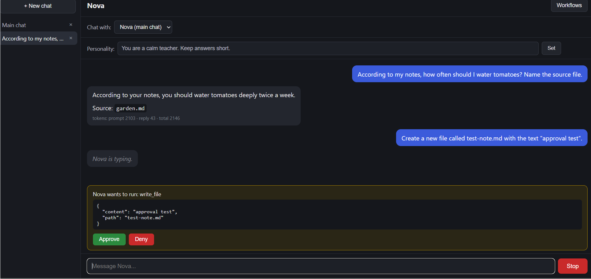
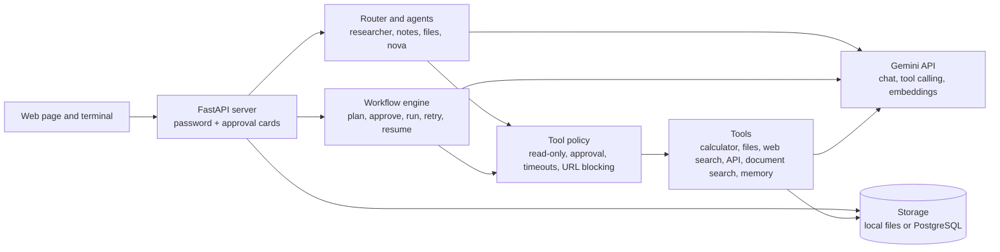

# Nova


Nova is a password-protected AI assistant built with Python and the Google Gemini API. It started as a command-line chat and now includes a web interface on a FastAPI backend, a tool-using agent, specialized agents with automatic routing, a workflow engine with browser approval, document search over your own files, long-term memory, and optional PostgreSQL storage.

## Live demo

Live app: https://nova-wwn8.onrender.com

The app is password-protected. The demo password is not published here, so ask me for it. The API docs are at https://nova-wwn8.onrender.com/docs and use the same login.

It runs on Render's free plan, so the first request after a quiet period can take up to a minute while the service wakes up. Documents and memory facts you add are wiped when the service restarts. See Demo walkthrough below for a five-minute tour.

## Screenshots

Nova answering a question from my own notes and naming the source file (`garden.md`):



The approval card that appears before a tool changes anything:



## Architecture



Every tool call goes through one policy layer. Agents only see the tools they are given, and anything that changes things waits for your approval.

## Features

- Password-protected web interface with a FastAPI backend, with saved conversations and an editable system prompt
- Streaming responses, printed as they are generated
- Tool-using agent: Gemini decides when to call a built-in tool
- Built-in tools: calculator, file tools, web search, an API request tool, document search and long-term memory
- Document search: add your own `.txt` and `.md` files from the web app or with `python -m rag add`, and Nova answers from them and names the source file
- Long-term memory: ask Nova to remember a fact and it knows it in every later chat, in the terminal and in the web app. Saving or forgetting a fact asks for your approval first
- Memory panel: a **Memory** button in the web app lists the saved facts, and lets you add a fact or delete one directly
- Specialized agents: a researcher, a notes agent and a read-only file agent, each with only the tools it needs, plus an auto mode that routes each question to the right one
- Safety layer around tools: read-only flags, confirmation before anything that changes things, timeouts and unsafe-URL blocking
- Browser approval: in the web app, a tool that needs approval shows an Approve / Deny card
- Workflow engine: plans a goal, shows the plan, asks for approval, runs it with retries and saves progress so it can be resumed. Works from the terminal and from a Workflows panel in the web app
- Storage behind one interface for chats, workflow runs and indexed documents: local files by default, PostgreSQL when `DATABASE_URL` is set
- A `Dockerfile` to run the web app in a container (see Docker below)
- Token usage shown after every reply
- Terminal commands: `/clear`, `/history`, `/model`, `/system` and `/agent`
- API keys, model name and password kept in a `.env` file

## Demo walkthrough

A five-minute tour of the live app, in this order:

1. **Login and chat.** The browser asks for a login. Use any username and the demo password. Ask a simple question and watch the reply stream in, with the token count after it.
2. **Documents.** Click **Documents**, add a `.md` or `.txt` file, then ask a question about it. Nova answers from the file and names it.
3. **Approval card.** Ask Nova to write a file. An Approve / Deny card appears, and nothing is written until you click **Approve**.
4. **Memory.** Say "remember that I prefer short answers", approve it, then open the **Memory** panel to see the saved fact.
5. **Workflow.** Click **Workflows**, type a goal, click **Plan**, review the plan, then **Run plan** and watch each step.
6. **Usage and API docs.** Click **Usage** for the tool usage report. Then open `/docs` to see every API route, behind the same password. **Try it out** works once you are logged in.

Under the hood: one FastAPI app with a single password check on every route, one policy layer for every tool call, and automated tests that run on every push.

## Setup

1. Clone the repo and open the folder.

2. Create and activate a virtual environment.

   Windows:

        python -m venv venv
        venv\Scripts\activate

   macOS / Linux:

        python -m venv venv
        source venv/bin/activate

3. Install the dependencies:

        pip install -r requirements.txt

4. Copy `.env.example` to `.env` and put your real values in it. The file looks like this:

        GEMINI_API_KEY=your_key_here
        GEMINI_MODEL=gemini-flash-lite-latest
        NOVA_PASSWORD=choose-a-password
        NOVA_SYSTEM_PROMPT=You are Nova, a friendly and precise AI assistant. Keep answers clear and concise.
        TAVILY_API_KEY=
        DATABASE_URL=
        NOVA_EMBED_MODEL=

   - `GEMINI_API_KEY` is required. Get a key from Google AI Studio.
   - `NOVA_PASSWORD` is required for the web app. If it is empty, the server refuses every request.
   - `TAVILY_API_KEY` is only needed for the web search tool.
   - `NOVA_EMBED_MODEL` is optional. Leave it empty to use `gemini-embedding-001`. See Documents below.
   - `DATABASE_URL` is optional. Leave it empty to save chats, workflow runs and indexed documents as local files. Set it to a PostgreSQL connection string to save them in a database. On your own computer, use a database's external URL; a host's internal URL only works from inside that host.
   - Never commit your `.env` file.

## Run

### Terminal chat

        python -m app.chat

Type `exit` to quit, `/clear` to forget the conversation, `/history` to see recent messages, `/model` to see the model in use, `/system` to see or change the personality, or `/agent` to talk to a specialized agent (see Specialized agents below). A tool that changes things asks you `[y/N]` in the terminal first.

### Web app

        uvicorn web.fastapi_app:app --port 8000

Open http://127.0.0.1:8000 in your browser. The browser asks for a login. Use any username and your `NOVA_PASSWORD`.

When Nova wants to run a tool that changes things, such as writing a file or calling an API, a card appears above the message box. Nothing runs until you click **Approve**, and **Deny** cancels it. If you don't answer within 60 seconds, it counts as a denial.

The **Memory** button in the header opens the memory panel (see Long-term memory below), the **Documents** button opens the document panel (see Documents below), and the **Workflows** button opens the workflow panel (see Workflows below).

## FastAPI backend

The web app's API is a FastAPI app in `web/fastapi_app.py`. Start it with:

        uvicorn web.fastapi_app:app --port 8000

Open http://127.0.0.1:8000 and log in with the password from `NOVA_PASSWORD`. Open http://127.0.0.1:8000/docs for a page that lists every API route and can try them. `/docs`, `/redoc` and `/openapi.json` sit behind the same password as everything else, so nothing about the API is visible without logging in. The browser asks for the login once and then remembers it, so **Try it out** works.

`web/server.py` holds the state the routes share (conversations, tools, approvals, workflows, personality, document index) and a small Flask app that serves only the chat page and the usage page. FastAPI mounts that Flask app, so both pages use the same password.

## Tools

Nova can call these tools when a request needs them:

- Calculator
- File tools: list, read and write files in the `workspace/` folder
- Web search (needs `TAVILY_API_KEY`)
- API request tool
- Document search: finds passages in the files you added, from the web app or with `python -m rag add` (see Documents below)
- Memory: `remember`, `forget` and `list_memories` (see Long-term memory below)

Tools are checked before they run. Read-only tools run freely, tools that change things need your approval, every call has a timeout, and the web and API tools refuse unsafe URLs.

## Long-term memory

Nova can remember short facts about you across chats, for example "I prefer short answers". Tell it in plain words:

- "Remember that I prefer short answers"
- "What do you remember about me?"
- "Forget that I prefer short answers"

Saving and forgetting a fact are tools that change things, so each one asks for your approval first (`[y/N]` in the terminal, an Approve / Deny card in the web app). Listing what Nova remembers needs no approval.

- Facts are saved in `memory_data/facts.json`, which is ignored by Git. The terminal chat and the web app share the same file.
- At the start of every chat, the saved facts are added to the system prompt as background information, not as instructions.
- Each fact is one line of at most 200 characters, and Nova keeps at most 50 facts. A repeated fact is saved only once.
- Nova is told to save only what you ask it to remember, never text that came from a web page, a document or another tool.
- Saved facts are sent to the Gemini API with every chat. Don't save anything you wouldn't send to Google.
- If the file is damaged, Nova moves it aside to `facts.json.bad` and starts with empty memory instead of failing.
- The facts file is a local file, not part of PostgreSQL. On a host with a disk that is wiped on restart (such as Render's free plan), saved facts are lost on restart.

### In the web app

Click **Memory** in the header. The panel shows every saved fact with a **Delete** button. To add a fact, type it in the box and press Enter or click **Add**. A message above the list says "Saved." or "Forgotten." when it worked, or shows the reason when it didn't.

- Changes made in the panel happen straight away. They don't ask for approval, because you are making them yourself. Deleting a fact asks you to confirm in a pop-up.
- The panel follows the same rules as Nova: at most 200 characters per fact, at most 50 facts, and a repeated fact is saved only once.
- Fact text is shown as plain text, never as HTML.

### In the web API

The memory routes sit behind the same password as the rest of the app.

- `GET /memory` lists the saved facts, each with an `id` and its `text`
- `POST /memory` with `{"fact": "..."}` saves a fact
- `DELETE /memory/<id>` forgets one fact

A request that can't be done returns `{"error": "..."}` with the reason.

## Documents

Nova can answer questions from your own notes. Add `.txt` or `.md` files and Nova searches them by meaning, so your question doesn't need the same words as the file. You can add files from the web app or from the terminal. Both use the same code, so they follow the same rules.

### In the web app

Click **Documents** in the header. Choose one or more `.txt` or `.md` files and click **Add**. Each file appears in the **Indexed documents** list with its number of chunks, and **Remove** deletes it from the index. Then ask Nova a question in the chat.

- Each file can be up to 300 KB. Other file types, empty files, and files that are not UTF-8 text are refused with a message next to the file name.
- Only the file name is kept, not any folder in its path.
- Adding a file with the same name replaces the old copy.
- If a file can't be embedded (for example the Gemini API is unreachable), nothing is stored for it.

### In the terminal

    python -m rag add notes.md garden.md
    python -m rag list
    python -m rag search "how often should I water tomatoes"
    python -m rag remove notes.md
    python -m rag clear

Then ask Nova a question in the terminal chat or the web app. When the answer is in your files, Nova uses the `search_documents` tool and names the source file.

### Notes

- Adding a file again replaces the old copy. Files up to 300 KB are accepted.
- Embeddings use `gemini-embedding-001`. Set `NOVA_EMBED_MODEL` to change it. Vectors from different models can't be compared, so after changing the model run `python -m rag clear` and add your files again.
- Storage follows `DATABASE_URL`: local files in `rag_data/` (ignored by Git) by default, or a table called `rag_chunks` in PostgreSQL.
- Adding files and searching send text to the Gemini API. Don't add anything you wouldn't send to Google.

### In the web API

The document routes sit behind the same password as the rest of the app.

- `GET /documents` lists the indexed documents with their chunk counts
- `POST /documents` uploads one file, sent as a form field named `file`. It returns `{"source": "...", "chunks": N}`
- `DELETE /documents/<name>` removes one document

## Workflows

Give Nova a goal in plain words. It plans the steps, shows you the plan, and runs nothing until you approve it. Nothing is saved until then either.

### In the terminal

        python -m workflows "list the files in my workspace folder"
        python -m workflows --list
        python -m workflows --resume WORKFLOW_ID

Options:

- `--write-tools` lets plans use tools that change things (each write still asks first)
- `--no-critic` skips the extra model review of the plan

### In the web app

Click **Workflows**, type a goal and click **Plan**. Review the plan, then click **Run plan** or **Discard**. While it runs you see each step's status, and a step that changes things shows the usual Approve / Deny card. A finished or interrupted run appears under **Saved workflows**, and unfinished ones have a **Resume** button.

- Tools that change things are off unless you tick **Allow tools that change things**.
- Only one workflow can plan or run at a time.
- **Cancel** stops the workflow after the current step.
- A workflow stops after 10 minutes.

## Specialized agents

Besides the main chat, Nova has small agents that each do one job with only the tools that job needs:

- `researcher`: web search and the calculator, for current facts and arithmetic
- `notes`: document search only, so it answers only from files you added to the documents
- `files`: lists and reads files in `workspace/`. Read-only
- `nova`: the general chat with every tool. Auto mode uses it for anything the specialists don't cover. It is the only agent that can write files or call APIs, and each of those still asks you first

An agent gets a copy of the main tool registry that holds only its tools, and the copy keeps the same approval policy and timeouts. A notes agent can't search the web or write files because those tools aren't there for it to call.

Each agent keeps its own saved conversation, separate from your main chat. A session resumes where the last one ended, in the terminal and in the web page alike.

### In the terminal

        python -m agents                      show usage and the list of agents
        python -m agents notes                chat with one agent
        python -m agents notes --clear        delete that agent's saved conversation
        python -m agents --route "my question"  show which agent would handle it

Type `exit` to leave an agent chat. Commands like `--clear` go in PowerShell or your shell, not at the `You:` prompt.

### Auto mode

        python -m agents --auto
        python -m agents --auto --smart
        python -m agents nova --clear

Each message goes to the first of these that applies:

1. The agent you pinned with `/use <agent>` (type `/auto` to go back to routing)
2. `nova`, if the message asks to create, write, save, edit or delete a file
3. The agent a simple keyword rule picks: `notes` for "my notes" or "my documents", `files` for file names and "list files", `researcher` for words like "latest", "news", "weather" and for arithmetic
4. The previous agent, if the message is four words or fewer ("and tomorrow?")
5. With `--smart` only: the model picks an agent. This costs one extra small Gemini call per message that no rule matched, and it isn't counted in the token line
6. `nova`

The reply is labelled with the agent that answered. The model can only choose from the agents above, and it can never move a file-writing request away from `nova`.

### Inside the terminal chat

Type `/agent` at the `You:` prompt to list the agents, or `/agent notes` to talk to one. Type `exit` to come back to the main chat.

### In the web app

The web page has a **Chat with:** dropdown under the header. It lists the agents, and picking one shows its description and tools. Each agent keeps its own saved conversation, and **Clear this agent's chat** deletes it. Pick **Nova (main chat)** to go back to the normal chat. Agent conversations are not listed in the sidebar.

### In the web API

The agent routes sit behind the same password as the rest of the app.

- `GET /api/agents` lists the agents and their tools
- `POST /api/agents/<name>/chat` with `{"message": "..."}` streams the reply as plain text, followed by a token line after a `\x00` byte, like `/chat`
- `GET /api/agents/<name>/history` returns the saved messages
- `DELETE /api/agents/<name>/history` clears them

`nova` and auto routing are not exposed over the web.

## Storage

Conversations, workflow runs and indexed documents are saved through small interfaces, so the storage can change without touching the rest of the app:

- **Files (default):** the main chat in `history.json`, other chats in `conversations/`, workflow runs and their event logs in `workflow_data/`, indexed documents in `rag_data/`.
- **PostgreSQL:** set `DATABASE_URL`. Nova creates its tables on first use: `conversations`, `workflow_runs`, `workflow_events` and `rag_chunks`.

Agent conversations use the same conversation storage as other chats, each under its own fixed id, so they never touch the main chat.

Long-term memory facts are always a local file, `memory_data/facts.json`, whatever `DATABASE_URL` is set to.

## Deploy to Render

1. Push the repo to GitHub and create a **Web Service** on Render from it.
2. Build command: `pip install -r requirements.txt`
3. Start command: `uvicorn web.fastapi_app:app --host 0.0.0.0 --port $PORT`
4. Add the variables from `.env` under **Environment**: at least `GEMINI_API_KEY`, `GEMINI_MODEL` and `NOVA_PASSWORD`. Optionally add `PYTHON_VERSION=3.12.3`.
5. To keep chats and workflow runs across restarts, create a **Postgres** database on Render in the same region, and add its **Internal Database URL** as `DATABASE_URL`.

Keep a single uvicorn process (don't add `--workers`). The workflow that is planning or running lives in the server's memory, so a second worker would not see it.

Notes for the free plan:

- The service sleeps after about 15 minutes without traffic, so the first request can take up to a minute.
- The disk is wiped on every restart, so without `DATABASE_URL`, saved chats, workflow runs and indexed documents are lost. Long-term memory facts are always lost on restart, because they are saved as a local file.
- A restart also stops a workflow that is running. Its progress is saved, so you can resume it from the panel.
- Free Render databases expire after 30 days. To renew: create a new free database, replace `DATABASE_URL` in **Environment** with its new Internal Database URL, then delete the old database. Chats and workflow runs saved in the old one are not carried over.

## Docker

The repo has a `Dockerfile` that runs the web app with uvicorn, one process, as a normal (non-root) user. A `.dockerignore` keeps your `.env`, chats, documents and saved facts out of the image.

**Status:** the image was built and run on Windows with Docker Desktop (WSL 2), with the app started by uvicorn. Login, chat, the Memory panel and the password-protected `/docs` page worked in the container, using local files for storage, and a saved memory fact was still there after the container was stopped and started again. It has not been tested with a PostgreSQL database from inside a container, or on macOS or Linux.

Build the image from the repo folder:

        docker build -t nova .

Run it. Your settings come from your `.env` file at run time and are never copied into the image:

        docker run --rm -p 8000:8000 --env-file .env -v nova_conversations:/app/conversations -v nova_workflows:/app/workflow_data -v nova_documents:/app/rag_data -v nova_memory:/app/memory_data -v nova_logs:/app/logs -v nova_workspace:/app/workspace nova

Then open http://127.0.0.1:8000 and log in with your `NOVA_PASSWORD`.

- `--env-file` takes each line as it is, so don't put quotes around values in `.env` when you use it.
- `localhost` in `DATABASE_URL` does not work inside a container, because there it means the container itself. The app then stops at start-up with a "Connection refused" error. For a PostgreSQL database on your own computer, use `host.docker.internal` instead of `localhost`. To use local files instead, add `-e DATABASE_URL=` to the `docker run` command, after `--env-file .env`. It overrides the value in `.env` for that run only.
- Each `-v name:/app/folder` option is a named Docker volume. It keeps that folder's files when the container is removed and started again. Without it, everything the container wrote is lost when it stops.
- The volumes cover other chats, workflow runs, indexed documents, saved memory facts, the usage log and the `workspace/` folder. The main chat (`history.json`) and the edited system prompt (`personality.json`) are not covered, so they are lost when the container is removed. Set `DATABASE_URL` to keep chats in PostgreSQL instead.
- The server listens on port 8000 inside the container, or on the `PORT` variable if the host sets one.
- Keep it to one process. A running workflow lives in the server's memory.

## Notes

`.env`, `history.json`, `personality.json`, `conversations/`, `workflow_data/`, `rag_data/`, `memory_data/` and `workspace/` are listed in `.gitignore`, so your keys, conversations, documents and saved facts are never pushed to GitHub. The same paths are listed in `.dockerignore`, so they are never copied into a Docker image either.

## Tests

Install the dev requirements and run the tests:

        pip install -r requirements-dev.txt
        python -m pytest

Tests run on every push with GitHub Actions. They use fake models, so they never call Gemini. The PostgreSQL tests are skipped unless `TEST_DATABASE_URL` is set.

## Tool usage log and evaluation

Every chat turn (terminal chat, web chat, agents and auto mode) appends one line to `logs/tool_usage.jsonl`. Each line records the time, the source, which tools ran, the tool call count and token usage. It never records your messages or Nova's replies.

When the log reaches 1 MB, it is moved to `tool_usage.jsonl.1` and a fresh log is started. Only one old file is kept, so the log never takes much more than 2 MB. The usage report reads the older file as well as the current one, so its totals don't drop to zero after a rotation. It covers at most the last two files, so once the log has been rotated again, the oldest turns are no longer counted.

Set `TOOL_LOG_PATH` in the environment or `.env` to write the log somewhere else. The `logs/` folder is ignored by git.

To see the totals, run `python -m app.usage_report` in the terminal, or click **Usage** in the web page header.

To check that Nova picks the right tools, run:

```
python -m evals.run_evals
```

This sends the questions in `evals/questions.json` to Gemini (real API calls, about 6,000 tokens each) using only read-only tools. A question passes when every expected tool was used. A question that expects no tools passes only if none were used. Results are saved to `evals/last_results.json`.

If the API answers with a rate limit error (429), the runner waits 60 seconds and tries that question again, then waits 120 seconds for a second retry, and marks the question failed if it still gets a 429. Other errors fail the question straight away. A line such as `rate limited, waiting 60s (retry 1 of 2)` is printed while it waits.

## Roadmap

Done: tools, workflows, conversation and workflow storage on PostgreSQL, browser approval for tool calls and for workflows, document search over your own files (RAG), document upload and removal in the web app, specialized agents with routing in the terminal, a web API and an agent panel in the web page, a tool usage log with a usage report, an evaluation runner, long-term memory with a Memory panel in the web app, a Dockerfile (built and run on Windows with uvicorn), a FastAPI backend, password-protected API docs, and a live demo on Render.

Planned next: test the Docker image with a PostgreSQL database from inside a container.

## License

Apache License 2.0. See [LICENSE](LICENSE).